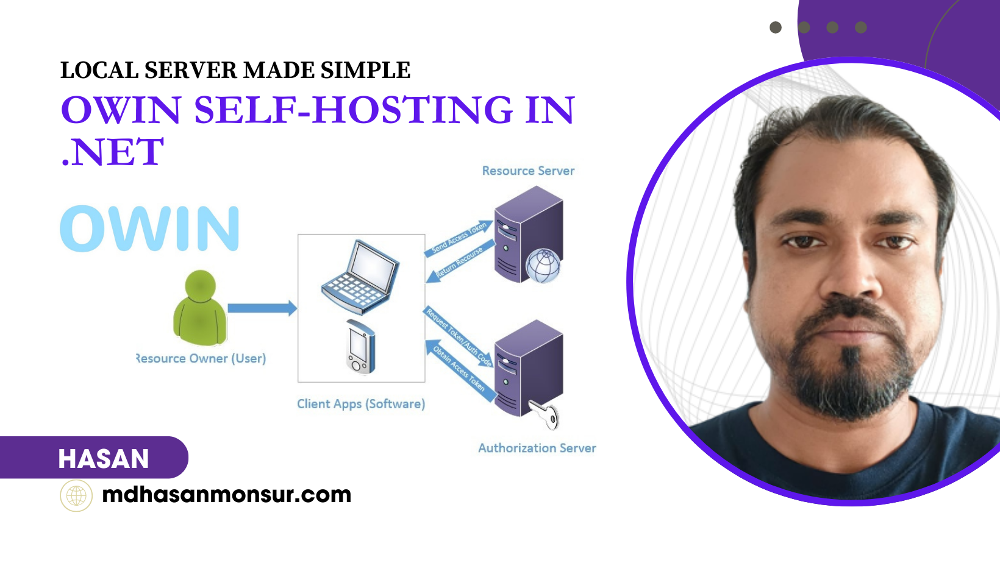
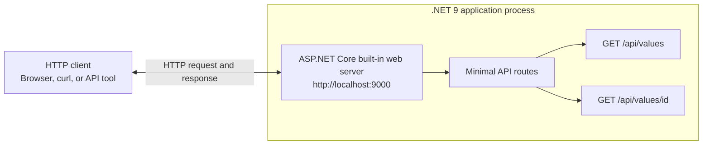
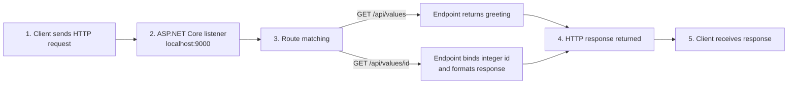
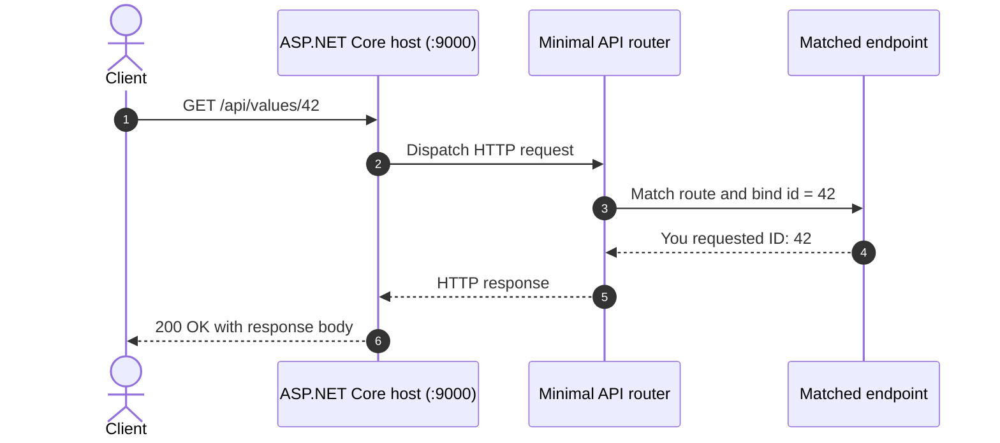

# ASP.NET Core Self-Hosting in .NET 9

A minimal example of **self-hosting an ASP.NET Core HTTP API** as a standalone .NET process. The application listens on `http://localhost:9000` and exposes two lightweight endpoints, making this repository a practical starting point for learning about .NET web hosting, minimal APIs, and local HTTP services.

> This project uses ASP.NET Core's built-in web server; it is not an OWIN-based implementation. The image and article below are retained from the repository's original README for background on the related OWIN self-hosting topic.



[Original article: OWIN Self-Hosting in .NET — Local Server Made Simple](https://medium.com/asp-dotnet/owin-self-hosting-in-net-local-server-made-simple-63dd540c3ecc)

## What this project does

- Builds a small ASP.NET Core application with .NET 9.
- Starts the web server directly from the application process.
- Listens at `http://localhost:9000`.
- Returns a greeting from `GET /api/values`.
- Returns the requested integer ID from `GET /api/values/{id}`.

This is a deliberately small demo: it does not currently include a database, authentication, a frontend portal, background workers, or external infrastructure such as Redis or RabbitMQ.

## System architecture

The diagram shows the components that are present in this repository. The client communicates over HTTP with the self-hosted ASP.NET Core application, which routes requests to the matching minimal API endpoint and returns a response. There is no separate reverse proxy or external service in the sample configuration.



## Data flow diagram



The sample endpoints return plain text. No request data is stored or forwarded to another service.

## HTTP request sequence



For `GET /api/values`, the router selects the greeting endpoint instead; the server lifecycle and response path are otherwise the same.

## Requirements

- [.NET 9 SDK](https://dotnet.microsoft.com/download/dotnet/9.0)
- A terminal or an IDE that supports .NET projects

## Run the application

Clone the repository and start the project:

```bash
git clone https://github.com/hasanmonsur/Self-Hosting-in-.NET.git
cd Self-Hosting-in-.NET
dotnet run
```

The application is configured in `Program.cs` to listen on `http://localhost:9000`.

Try the endpoints in another terminal:

```bash
curl http://localhost:9000/api/values
curl http://localhost:9000/api/values/42
```

Expected response bodies:

```text
Hello from ASP.NET Core Self-Hosting!
You requested ID: 42
```

## Benefits

- **Simple to understand:** a small `Program.cs` demonstrates hosting and endpoint mapping without unnecessary layers.
- **Standalone local service:** run the web server as part of the .NET application process for development, demos, or controlled internal tools.
- **Fast to try:** the .NET CLI and curl are enough to run and exercise the sample.
- **Easy to extend:** add middleware, dependency injection, configuration, or additional API routes as requirements grow.
- **Useful learning example:** see how an ASP.NET Core minimal API handles an HTTP request from listener to response.

## Use cases

This starter is appropriate for learning and prototypes such as:

- A local HTTP API used by a desktop application or development tool.
- A small internal service running on a trusted host.
- A proof of concept for ASP.NET Core minimal APIs and self-hosted web applications.
- A base for experimenting with middleware, route handling, and service registration.

For production or network-accessible deployments, configure HTTPS, authentication and authorization, logging, health checks, deployment and process management, and appropriate network/firewall controls. The current sample binds to `localhost` and is not a production-ready security configuration.

## Project structure

| File | Purpose |
| --- | --- |
| `Program.cs` | Configures and starts the web application and maps the sample API routes. |
| `AspNetCoreSelfHost.csproj` | Targets .NET 9 and declares the ASP.NET Core OpenAPI package dependency. |
| `AspNetCoreSelfHost.http` | Contains an HTTP client request example. |

## Search keywords

ASP.NET Core self-hosting, self-hosted .NET web server, .NET 9 minimal API, local HTTP API, ASP.NET Core web application, C# API tutorial, run ASP.NET Core locally.

> Search ranking depends on many factors outside this repository, including competition, links, and search-engine indexing. Clear documentation can improve discoverability, but no README can guarantee a top-10 search position.

## License

See the repository for license information.
